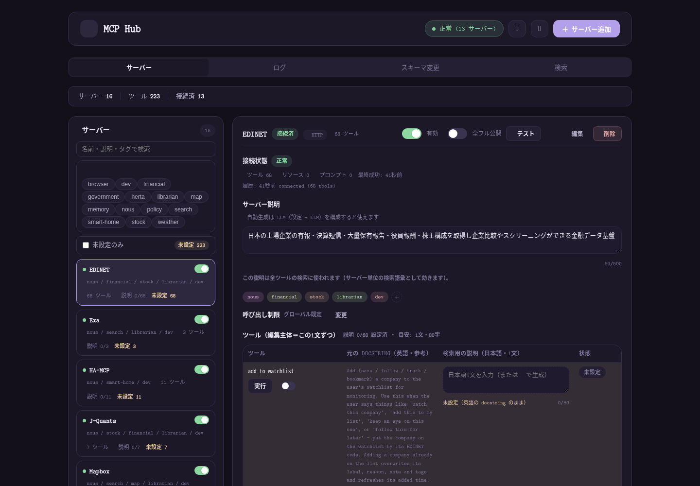
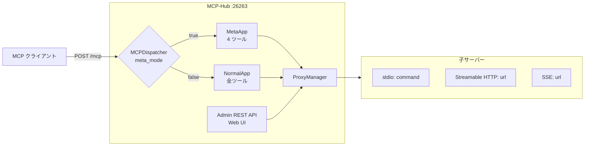

#  MCP-Hub

[](LICENSE) [](https://github.com/solidlime/MCP-Hub/actions/workflows/ci.yml)

複数の MCP サーバーを 1 つのエンドポイントに集約するプロキシ兼レジストリです。stdio で起動する子サーバーも、HTTP で動くリモートサーバーも、MCP クライアントには `http://localhost:26263/mcp` の 1 つのエンドポイントとして見えます。



**Contents**

- [クイックスタート](#クイックスタート)
- [機能](#機能)
- [仕組み](#仕組み)
  - [リクエストの流れ](#リクエストの流れ)
  - [Progressive Discovery](#progressive-discovery)
  - [検索と索引](#検索と索引)
- [管理画面と管理 API](#管理画面と管理-api)
- [設定](#設定)
  - [設定ファイル](#設定ファイル)
  - [環境変数](#環境変数)
- [パフォーマンス](#パフォーマンス)
- [デプロイ](#デプロイ)
- [セキュリティ](#セキュリティ)
- [開発](#開発)
- [既知の制限](#既知の制限)
- [ドキュメント](#ドキュメント)
- [コントリビュート](#コントリビュート)
- [ライセンス](#ライセンス)

## クイックスタート

Python 3.12 以上が必要です。

```bash
git clone https://github.com/solidlime/MCP-Hub.git
cd MCP-Hub
uv sync
uv run python -m mcp_hub.main
```

`uv` を使わない場合は `pip install -e .` で入れてから `python -m mcp_hub.main` で起動します。

起動すると、管理画面は `http://localhost:26263/admin/` で開けます。MCP クライアント側の接続先は `http://localhost:26263/mcp` です。

```json
{
  "mcpServers": {
    "mcp-hub": {
      "url": "http://localhost:26263/mcp"
    }
  }
}
```

上の設定は Claude Desktop の `claude_desktop_config.json` にそのまま書けます。`/admin/api/health` は `status`、`servers`（接続中の子サーバー数）、`embedding_status` を返すので、起動確認に使えます。

タグで範囲を絞りたいときは接続先に `?tags=` を付けます。

```json
{
  "mcpServers": {
    "mcp-hub": {
      "url": "http://localhost:26263/mcp?tags=web,local"
    }
  }
}
```

子サーバーは `data/hub.config.json` に書くか、管理画面の「サーバー追加」から登録します。初回起動時は同梱の `hub.config.json` から `data/hub.config.json` を生成します。

## 機能

- 単一エンドポイント: 登録した子サーバーのツール・リソース・プロンプトを `/mcp` から公開します
- 転送方式の吸収: `command`（stdio）と `url`（Streamable HTTP / SSE）を同じレジストリで扱います
- タグフィルタ: `X-MCP-Hub-Tags` ヘッダーか `?tags=` で、公開するサーバーを OR 一致で絞ります
- Progressive Discovery: `meta_mode` では検索と実行の 4 ツールだけを公開します
- ハイブリッド検索: BM25 と埋め込みを RRF（k=60）で統合し、日本語は CJK 分割で索引します
- 管理画面: 追加・編集・削除、接続状態、ツールログ、スキーマ差分、モジュール導入をブラウザから操作できます
- モジュール導入: `pip`、`uv`、`uv-tool`、`npm` を固定 argv で実行し、シェルを介しません
- ヘルスチェック: 60 秒間隔で子サーバーの疎通を確認し、落ちたものは間隔を空けて再接続します
- 認証と入力検証: 管理 API の `X-API-Key` 認証と、コマンド・URL の検証を備えます
- Prometheus メトリクス: `/metrics` で稼働時間と登録数を公開します

## 仕組み



### リクエストの流れ

`POST /mcp` は `src/mcp_hub/main.py` の `MCPDispatcher` が受けます。`meta_mode` の値をキャッシュから読み、`true` なら 3 つの検索系ツールと `execute_tool` だけを持つ MetaApp に、`false` なら全ツールを並べた NormalApp に振り分けます。どちらの側も子サーバーへの転送は `ProxyManager` が担当し、接続・リトライ・タイムアウトはそこに集約されています。

タグはリクエストごとに ContextVar へ入ります。ミドルウェアが `tools/list` と `tools/call` の両方で同じ判定関数（`state.tags_match`）を使うため、一覧に出ないツールは呼び出しもできません。

### Progressive Discovery

`meta_mode` で公開されるツールは 4 つです。

- `search_tools`: やりたいことを渡すと候補を返します。既定は top 3 で、`inputSchema` を含まない brief 形式
- `search_resources`: リソース、リソーステンプレート、プロンプトを同じ索引から探します
- `get_schema`: 1 ツールの完全な `inputSchema` を返します
- `execute_tool`: 見つけたツールを `server` と `tool_name` で実行します

`full_info_tools` に `"{server}_{tool}"` を入れると、そのツールだけは meta_mode でも通常ツールとして `tools/list` に並び、`execute_tool` を経由せず直接呼べます。

### 検索と索引

索引は子サーバーの接続時に作り直します。BM25 のスコアと埋め込みの候補を RRF で合成し、希少トークンに一致したツールを優先する name-match promotion を前段に置いています。

索引に使うテキストと、画面に出す説明は別に組み立てています。`index_text` はサーバー説明とツール単位の検索ヒント（`tool_search_desc`）を含み、`description` は表示用に切り詰めた説明です。日本語クエリは CJK の連続区間を全体 + bigram + unigram に分割して索引するため、「検索」で「検索して」を含むツールにも当たります。

既定の埋め込みモデルは `cl-nagoya/ruri-v3-30m` です。`embeddings` エクストラ（`fastembed`、`onnxruntime`、`tokenizers`）を入れると意味検索が有効になります。`MCP_HUB_EMBEDDING=0` を設定した場合は BM25 だけで検索します。埋め込みの文書キャッシュは `~/.cache/mcp-hub/embeddings` に置き、`MCP_HUB_EMBED_CACHE_DIR` で場所を変えられます。

## 管理画面と管理 API

管理画面は `/admin/` で配信される 1 枚の HTML で、サーバー・ログ・スキーマ変更・検索のタブを持ちます。REST 側の入口は `/admin/api` です。

| エンドポイント | メソッド | 内容 |
|---|---|---|
| `/admin/api/health` | GET | 稼働状態。認証の対象外 |
| `/admin/api/servers` | GET, POST | サーバー一覧、追加 |
| `/admin/api/servers/{name}` | PATCH, DELETE | 編集、削除 |
| `/admin/api/servers/{name}/test` | POST | 接続テスト |
| `/admin/api/servers/{name}/limits` | PATCH | 呼び出し制限の変更 |
| `/admin/api/servers/{name}/tools/{tool_name}/call` | POST | ツールを直接実行 |
| `/admin/api/logs` | GET | ツール呼び出しと接続イベント（メモリ上に 500 件） |
| `/admin/api/schema-diffs` | GET | ツールスキーマの差分 |
| `/admin/api/discovery/search` | GET | 索引の検索 |
| `/admin/api/tools/install` | POST | モジュールの導入 |
| `/admin/api/settings` | GET, PATCH | meta_mode などの設定 |
| `/metrics` | GET | Prometheus 形式。認証の対象外 |

各エンドポイントのリクエスト・レスポンスは [API リファレンス](docs/api-reference.md) にあります。

## 設定

### 設定ファイル

設定は `MCP_HUB_DATA_DIR`（既定は `data/`）の `hub.config.json` です。`${VAR}` と `${VAR:-default}` は起動時に環境変数から展開されます。

```json
{
  "version": 1,
  "log_level": "info",
  "meta_mode": true,
  "embedding_model": "cl-nagoya/ruri-v3-30m",
  "full_info_tools": ["fetch_fetch"],
  "mcpServers": {
    "filesystem": {
      "command": "npx",
      "args": ["-y", "@modelcontextprotocol/server-filesystem", "/tmp"],
      "env": { "DEBUG": "${DEBUG:-0}" },
      "tags": ["local"],
      "disabled": false
    },
    "remote-tools": {
      "url": "https://mcp.example.com/mcp",
      "headers": { "Authorization": "Bearer ${REMOTE_TOKEN}" },
      "tags": ["web"]
    }
  }
}
```

| キー | 内容 |
|---|---|
| `command` / `args` / `env` | stdio で起動する子サーバー |
| `url` / `headers` | Streamable HTTP または SSE のリモートサーバー |
| `tags` | フィルタ用のタグ。OR 一致で判定します |
| `disabled` | `true` の間は接続しません |
| `meta_mode` | `true` で Progressive Discovery を有効にします |
| `full_info_tools` | meta_mode でも直接公開する `"{server}_{tool}"` の一覧 |
| `embedding_model` | 意味検索に使う埋め込みモデル |

### 環境変数

| 変数 | 既定 | 内容 |
|---|---|---|
| `MCP_HUB_PORT` | `26263` | 待ち受けポート |
| `MCP_HUB_HOST` | `0.0.0.0` | バインドアドレス |
| `MCP_HUB_DATA_DIR` | `data` | 設定と DB の保存先 |
| `MCP_HUB_API_KEY` | なし | 設定すると `/admin/api/*` に `X-API-Key` が必要になります |
| `MCP_HUB_LOG` | `text` | `json` で構造化ログを出します |
| `MCP_HUB_RESEED` | なし | `1` で `mcpServers` を同梱の `hub.config.json` から作り直します |
| `MCP_HUB_EMBEDDING` | `1` | `0` で意味検索を無効にします |
| `MCP_HUB_EMBED_CACHE_DIR` | `~/.cache/mcp-hub/embeddings` | 埋め込みの文書キャッシュ先 |
| `MCP_HUB_HEALTH_INTERVAL` | `60` | ヘルスチェックの間隔（秒）。0 以下で無効 |
| `MCP_HUB_HEALTH_TIMEOUT` | `25` | ヘルスチェックのタイムアウト（秒） |
| `MCP_HUB_HEALTH_MAX_FAILURES` | `3` | 連続失敗を何回で切断とみなすか |
| `MCP_HUB_RETRY_MAX` | `3` | 接続の最大リトライ回数 |
| `MCP_HUB_RETRY_DELAY` | `1.0` | リトライの基準遅延（秒、指数バックオフ） |
| `MCP_HUB_RECOVERY_COOLDOWN` | `300.0` | 落ちたサーバーへの再接続試行の最小間隔（秒） |
| `MCP_HUB_CONNECT_TIMEOUT` | `30.0` | 起動時接続のタイムアウト（秒） |
| `MCP_HUB_CLIENT_TIMEOUT` | `180.0` | 上流の読み取りタイムアウト（秒） |
| `MCP_HUB_CALL_TOOL_TIMEOUT` | `30` | ツール呼び出しのタイムアウト（秒） |
| `MCP_HUB_LIST_TOOLS_TIMEOUT` | `10.0` | `list_tools` 集約のタイムアウト（秒） |
| `MCP_HUB_LIST_TOOLS_RETRY_DELAY` | `0.3` | `list_tools` のリトライ遅延（秒） |
| `MCP_HUB_MAX_CONCURRENT_CALLS` | `50` | 同時ツール呼び出しの上限 |
| `MCP_HUB_SESSION_IDLE_TIMEOUT` | なし | 上流セッションのアイドル期限（秒） |

全項目と既定値の根拠は [設定リファレンス](docs/configuration.md) にあります。

## パフォーマンス

`.benchmarks/results.json` の記録（2026-07-18、モデルは `tencent/hy3:free`、7 タスクを各 3 回）です。

| モード | 正しいツールを選べた回数 |
|---|---|
| meta_mode OFF | 6 / 21（28.6%） |
| meta_mode ON | 18 / 21（85.7%） |

差が出たのはブラウザ操作系でした。`puppeteer_navigate`、`puppeteer_screenshot`、`puppeteer_click`、`puppeteer_fill` は OFF で 0/3、ON で 3/3 です。検索系は両モードとも 3/3、`sequentialthinking` は両モードとも 0/3 でした。

ツール定義の量も減ります。管理画面の実測では、16 サーバー・223 ツールを登録した状態でも meta_mode の `tools/list` が返すのは 4 ツール分です。

再現するには OpenRouter のキーを設定して、どちらかのスクリプトを実行します。

```bash
export OPENROUTER_API_KEY=sk-or-v1-...
python .benchmarks/meta_mode_benchmark.py
python scripts/benchmark_toolcall.py --trials 3
```

`benchmark_toolcall.py` は `EXA_API_KEY` がある場合だけ exa の行を計測します。モデルは `OPENROUTER_MODEL` で差し替えられます。

## デプロイ

`ghcr.io/solidlime/mcp-hub:latest` を公開しています。同梱の `docker-compose.yml` は `MCP_HUB_DATA_DIR` を `/home/mcp-hub/data` に置き、`docker.sock` をマウントします。

```bash
docker compose up -d
```

イメージを自分でビルドする場合:

```bash
docker build -t mcp-hub .
docker run -d --name mcp-hub -p 26263:26263 \
  -v "$PWD/data:/opt/mcp-hub/data" \
  ghcr.io/solidlime/mcp-hub:latest
```

`docker-entrypoint.sh` はデータディレクトリの所有者から `PUID`/`PGID` を自動検出します。合わない場合は両方を環境変数で指定してください。

`docker.sock` を渡す構成では、子サーバーがホストの Docker を操作できます。信頼できるサーバーだけを登録する環境で使ってください。

## セキュリティ

- 入力検証: サーバー名は `[a-zA-Z0-9_.-]` の 128 文字まで。`command` 内の `;`、`|`、`$()`、バッククォートなどは拒否します
- 管理 API 認証: `MCP_HUB_API_KEY` を設定すると `/admin/api/*` に `X-API-Key` が必要になります。`/admin/api/health` と `/metrics` は対象外です
- モジュール導入: 固定 argv で `pip`、`uv`、`uv-tool`、`npm` を呼び、シェルを介しません。`--target` 以外のフラグは拒否します
- ログのマスキング: ツール引数とエラーのうち API キーやトークンは `***` に置換してから記録します。ログはメモリ上に 500 件だけ保持します
- 同時実行の制限: `MCP_HUB_MAX_CONCURRENT_CALLS`（既定 50）で上限を設けています
- 子サーバーの権限: 子サーバーは Hub と同じ権限で動きます。信頼できるものだけ登録してください

検証の範囲と供給網の保護は [セキュリティモデル](docs/security.md) にまとめています。

## 開発

```bash
uv sync --group dev
./scripts/run-tests.sh
uv run ruff check src/ tests/
uv run mypy src/ --ignore-missing-imports
```

`scripts/run-tests.sh` はテストファイルごとに別プロセスを立て、`systemd-run` の cgroup でメモリを 3G に制限します。埋め込みモデルが 1 プロセスあたり数百 MB を使うため、単一プロセスで全テストを走らせると 7GB 級の環境では OOM になります。1 ファイルだけ回すときは `TEST_FILE=tests/test_validators.py ./scripts/run-tests.sh` を使ってください。

CI は uv で同じコマンドを実行し、Ruff、mypy、pytest、WebUI の JS 構文チェックを通します。main の CI が成功したコミットだけが `ghcr.io/solidlime/mcp-hub` に push されます。

```
src/mcp_hub/
├── main.py                  # FastAPI アプリ、MCPDispatcher、/mcp のマウント
├── proxy_manager.py          # 子サーバーの接続・呼び出し・ヘルスチェック
├── meta_provider.py          # ToolIndex、MetaTools、MetaApp
├── admin_router.py           # /admin/api/*
├── static/index.html         # 管理画面
├── store.py                  # hub.config.json の読み書き
├── registry.py               # レジストリ操作
├── tag_filter.py             # タグフィルタ
├── validators.py             # 入力検証
├── auth.py                   # X-API-Key 認証
├── bootstrap.py              # 初回起動時のセットアップ
└── config.py                 # 設定ファイルの読み込み
```

コーディングエージェント向けの指示は [AGENTS.md](AGENTS.md) にあります。

## 既知の制限

- Progress Notification は転送されません。長時間動くツールの進捗はクライアントから見えません
- FastMCP の内部 API（`FastMCP._mcp_server`、`session_manager`、`StreamableHTTPASGIApp` など）に依存しています。`fastmcp>=4.0,<5.0` にピン留めし、5.0 以上を検出したときは起動時に警告を出します
- SSE の再接続は FastMCP のクライアント実装に任せています

経緯と影響範囲は [アーキテクチャ](docs/architecture.md) にあります。

## ドキュメント

| ドキュメント | 内容 |
|---|---|
| [設定リファレンス](docs/configuration.md) | 設定ファイルの全キー、環境変数、タグフィルタ |
| [API リファレンス](docs/api-reference.md) | `/mcp` のプロトコル、管理 REST API、Web UI |
| [アーキテクチャ](docs/architecture.md) | 内部設計、Progressive Discovery、制限事項 |
| [セキュリティ](docs/security.md) | 検証、認証、供給網の保護 |
| [開発ガイド](docs/development.md) | 開発環境、プロジェクト構造 |

## コントリビュート

個人プロジェクトです。バグや要望は issue に書いてください。fork して使うのも自由です。

## ライセンス

MIT ライセンスです。全文は [LICENSE](LICENSE) にあります。
